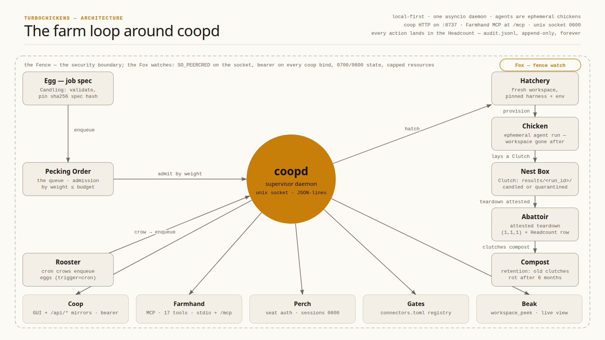

# TurboChickens — architecture

TurboChickens (package `turbochickens` v0.0.24, Python >=3.12, CLI binary `tc`) is a
local-first management platform for ephemeral, just-in-time AI agent jobs: one always-on
supervisor daemon, **coopd**, plus one CLI, `tc`. Agents are not co-workers — they are
ephemeral **Chickens** hatched from **Eggs** (job specs): each Chicken is spawned
deterministically into a fresh workspace, fed by a **Feeder** within its **Feed Budget**,
expected to lay a schema-validated **Clutch** in the **Nest Box**, and verifiably destroyed
by the **Abattoir** when the job ends. The platform is the durable thing; the Chickens are
not. Everything below is verified against the code in `src/turbochickens/`; the naming
register is [docs/lexicon.md](docs/lexicon.md).

## The farm loop



ASCII fallback of the same picture:

```
┌─ the Fence — the security boundary; the Fox watches ────────────────────────┐
│                                                                              │
│  Egg (job.toml) ──enqueue──▶ Pecking Order ──admit by weight──▶ ( coopd )    │
│  (candled, sha256 pinned)                          ▲  │ hatch               │
│  Rooster (cron) ──crow: enqueue trigger=cron───────┘  ▼                      │
│                                              Hatchery ─▶ Chicken           │
│                                                   │ lays a Clutch            │
│                                                   ▼                          │
│                                             Nest Box ─▶ Abattoir ─▶ Compost │
│  side nodes around coopd: Coop (GUI + /api/*) · Farmhand (MCP, /mcp) ·       │
│  Perch (seat auth) · Gates (connectors.toml) · Beak (workspace_peek)         │
└──────────────────────────────────────────────────────────────────────────────┘
```

- **Egg + Candling** — a `job.toml` plus its prompt, schema, and attachments. Candling
  (`spec/loader.py`) validates it with field-named errors and pins a `sha256:` spec hash;
  every file ref must stay inside the egg's own directory (the Fence).
- **Pecking Order** — the queue. Eggs wait here until admission by resource weight.
- **Rooster** — cron (`scheduler.py`, APScheduler). A crow enqueues with
  `trigger="cron"` through the same socket, so manual and cron chickens share one queue.
- **coopd** — the hub: one asyncio process serving JSON-lines ops on a 0600 unix socket.
- **Hatchery** — provisioning (`runner.py`): fresh workspace, pinned harness, per-run env.
- **Chicken** — the ephemeral agent run (vibe-cli subprocess or mistral-api call), under
  its Feed Budget (`timeout_sec`, `max_context_mb`, optional `max_cost_usd`; Free-Range
  removes the wall-clock kill).
- **Clutch + Nest Box** — the validated result artifacts under `results/<run_id>/`;
  invalid output is quarantined, never served as valid.
- **Abattoir** — attested teardown on every terminal state: process reaped, workspace
  removed, env cleared, `abattoir.attested` in the Headcount.
- **Compost** — retention: old clutches rot after `results_retention_months`; the
  Headcount is kept forever.
- **Fox / Fence** — the security boundary: peer credentials on the socket, bearer on every
  Coop bind, restrictive 0700/0600 state, resource caps (see [SECURITY.md](SECURITY.md)).

## Module map

One line per file in `src/turbochickens/`, with the lexicon term it maps to:

| File | Responsibility |
| --- | --- |
| `__init__.py`, `__main__.py` | Package version from installed metadata (`importlib.metadata.version("turbochickens")`, fallback `0.0.0+unknown`); `python -m turbochickens` runs the CLI. |
| `util.py` | UTC timestamps (`utcnow_iso`), log-line sanitizing, host-path redaction, data-dir-relative display paths. |
| `settings.py` | The `Settings` model (Pydantic, `extra="forbid"`) and `load_settings()`; resolution order `--settings` > `$TURBOCHICKENS_SETTINGS` > `~/.turbochickens/settings.toml` > built-in defaults; all state path properties (`socket_path`, `db_path`, `audit_log_path`, `results_dir`, `quarantine_dir`, `seats_dir`, `uploads_dir`); `weight_budget` / `default_weight_budget()`; the Fence's cap constants; `public_dict()` — the GUI view of settings, which never includes `coop_auth_token`. |
| `spec/model.py` | The Egg's Pydantic v2 model: `[job]`, `[trigger]`, `[harness]`, `[resources]`, `[input]`, `[output]`, `extra="forbid"`, deliberately no `max_tokens`; Free-Range/`timeout_sec` pairing, `spawn_subs`, `connectors`, `nestbox://` URI shape. |
| `spec/loader.py` | Candling of an Egg file: `load_spec()` (parse + validate + Fence check of every file ref) and `spec_hash()` — the sha256 over the canonical JSON of the validated model. |
| `validate.py` | Candling of a Clutch: `validate_output()` checks raw harness output against the egg's JSON schema (Draft 2020-12 + format checker); never raises — bad output is data and lands in quarantine. |
| `daemon.py` | coopd: the always-on asyncio supervisor. Binds the unix socket (0600, `SO_PEERCRED` read per connection), dispatches the JSON-lines ops (`ping`, `status`, `enqueue`, `runs_list`/`runs_show`/`runs_logs`, `run_stop`, `run_rerun`, `workspace_peek`, `results_get`, `schedule_add`/`schedule_list`/`schedule_rm`, `jobs_list`, `jobs_upload`, `audit_tail`, `settings_get`, `settings_set`, `auth_*`, `connectors_*`, `farmhand_info`, `shutdown`), runs the Pecking Order with weight admission, recovers stale queued rows at startup, cancels its own queued eggs at shutdown, and starts the Coop before the socket accepts when `coop_enabled`. |
| `runner.py` | The Hatchery: `RunPipeline` drives one queued Egg to a terminal state — hatch-time spec-hash re-verify (fail closed), provisioning (fence re-check, fresh workspace, Chaining resolution, context cap), harness execution under the Feed Budget, finalize (manifest, Clutch store or quarantine, cost cap), and the Abattoir's attested teardown plus Headcount rows. `TERMINAL_STATES = ("succeeded", "failed", "cancelled", "stopped")`; `STOP_TERM_GRACE_SEC = 5.0`. |
| `adapter.py` | The harness adapter interface (`prepare` / `execute` / `teardown` over a `RunContext`) and the two Feeder adapters: `VibeCLIAdapter` (headless subprocess) and `MistralAPIAdapter` (httpx, OpenAI-compatible, backoff on 429/5xx). `ADAPTER_WEIGHTS = {"mistral-api": 0.25, "vibe-cli": 1.0}`; per-run env with the credential allowlist and the per-run Scratch home. |
| `coop.py` | The Coop: aiohttp HTTP server in the daemon's own event loop. `GET /api/ping` (the Pong — open healthcheck) plus `/api/*` routes that are thin mirrors of the socket ops over the transport seam, behind the bearer middleware (constant-time compare; required on every bind unless `coop_loopback_open`), request hardening (Host/Origin/Referer), connection/handler caps, and the static SPA at `/`. Always registers the Farmhand route at `farmhand_https_path` (404 while unmounted). |
| `coop_static/` | The dependency-free SPA (`index.html`, `app.js`, `styles.css`, local lucide SVG icons): sidebar shell with the Dashboard, Chickens, Eggs, Rooster, Feed, Headcount, Settings, Perch, Farmhand, and Gates views; each view polls its `/api/*` endpoint every 2 s with flash-on-change. |
| `farmhand.py` | The Farmhand: an MCP server (official `mcp` SDK) whose 17 tools are thin wrappers over the daemon's socket ops via `client.request_async`. Transports stdio / https / both (`tc farmhand serve --transport …`); the https endpoint is streamable-HTTP at `farmhand_https_path` (default `/mcp`) mounted on the Coop's existing listener through an ASGI bridge. `spawn_subs` attaches the Farmhand to a Chicken's runtime over stdio with a narrowed sub scope. |
| `client.py` | The JSON-lines socket client (`request` / `request_async`), `DaemonUnreachable` for every failure mode, 5 s default round-trip timeout, `SOCKET_STREAM_LIMIT` stream cap. |
| `scheduler.py` | The Rooster: `CronScheduler` over APScheduler (with the POSIX-vs-APScheduler day-of-week fix, `misfire_grace_time=300`, coalescing); a crow fires `enqueue` with `trigger="cron"` over the socket. Schedules persist in the `schedules` table and re-register on start. |
| `storage.py` | SQLite storage (schema v5): `job_specs`, `runs` (incl. `parent_run_id` for ChickenSubs), `run_events`, `results`, `teardown_attestations`, `job_usage_stats`, `schedules`, `schema_meta`. Append-only triggers on `job_specs`, `run_events`, `results`, `teardown_attestations`; in-place migrations for older DBs; the db file is 0600. |
| `audit.py` | The Headcount: append-only JSONL `audit.jsonl` (0600, fsync per row, never TTL-deleted); every row carries a server-stamped `via` actor (`socket` / `http` / `farmhand` / `rooster`); legacy event names are aliased to lexicon names on read only. |
| `retention.py` | The Compost: `sweep_expired_results()` deletes on-disk artifacts older than `results_retention_months`, only ever inside `results/` and `quarantine/`, audit-logging each as `clutch.composted`; the append-only `results` rows stay. |
| `stats.py` | The Feed Ledger rollup: per-egg n, mean/p50/p95 tokens in/out and total, from finished chickens. |
| `providers.py` | The Feeders registry: `providers.toml` resolved as `providers_path` > `$TURBOCHICKENS_PROVIDERS` > `<data_dir>/providers.toml` > built-in Mistral defaults; per-provider overlay; USD-per-Mtoken pricing and context windows live in config, not code. |
| `seat.py` | The Perch: seat auth for `auth = "seat"` providers — OAuth device flow (`tc auth login`), sessions 0600 under `seats/`, automatic fail-closed refresh; only non-secret telemetry (mode + token expiry) ever leaves the module. |
| `models.py` | Model discovery (`tc models list`): live `GET /models` per Feeder (env key or seat token, never printed) plus the vibe-cli catalog via a sentinel-model probe; backs `tc jobs validate` model checks. |
| `connectors.py` | The Gates registry: `connectors.toml` resolved as `connectors_path` > `$TURBOCHICKENS_CONNECTORS` > `<data_dir>/connectors.toml` (no file = no gates); stdio/https entries with secret `$VAR` refs; literal https header secrets refused at registration; listings serve non-secret summaries only; opted-in gates are injected into the Chicken's harness MCP config at provisioning. |
| `chaining.py` | Chaining: the `nestbox://<run_id>/output.json` URI shape (validated at spec load) and resolution from the Nest Box at provisioning — valid clutches only; quarantined, composted, or missing clutches fail the run closed. |
| `beak.py` | The Beak: the pure seam behind the `workspace_peek` op — a running Chicken's workspace tree (capped at 1000 entries) or one size-capped file (64 KiB, `truncated` flag), path-locked inside the workspace with symlink-safe `O_NOFOLLOW` opens; the Chicken's private harness config is refused by resolved target. |
| `fence.py` | The Fence rule itself: `safe_ref` (relative POSIX refs only) + `resolve_contained` (symlink-safe containment under the base) — the one shared check used by Candling, the Hatchery's re-check, and the Beak's path lock. |
| `fox.py` | The Fox: restrictive umask (0o077) at daemon start plus explicit 0700 dirs / 0600 files on every created state, and the security-headers middleware (CSP `default-src 'self'`, `X-Frame-Options: DENY`, `nosniff`) on every Coop/Farmhand response. |
| `spec/__init__.py`, `cli/__init__.py` | Subpackage markers: the spec loader/model package and the CLI package. |
| `cli/main.py` | The `tc` CLI (Typer): `run [--wait]`, `runs list|show|logs|stop|rerun`, `results get`, `jobs validate`, `daemon start|stop`, `coop start`, `schedule add|list|rm`, `stats list|show`, `auth login|status|logout`, `models list`, `farmhand serve --transport stdio|https|both`, `connectors list|add|rm`, `status`. |

## Data flow — one Egg's journey

1. **Socket op.** The CLI (`tc run`), the Coop (`POST /api/runs`), the Farmhand's
   `enqueue` tool, or a Rooster crow each send one JSON line over the unix socket —
   `{"op": "enqueue", "protocol": 1, "spec_path": …, "spec_hash": …, "trigger": …}`
   (`client.py`; the socket is bound 0600, `daemon.py:547-553`, and the peer's
   `SO_PEERCRED` credentials are read on every connection, `daemon.py:330,643`, so a
   Chicken-owned connection is recognized and scoped server-side).
2. **Daemon handler.** `_dispatch_op` (`daemon.py:805`) routes to `_enqueue`
   (`daemon.py:972`): the Egg is candled (`load_spec`), hashed, and the `sha256:` digest
   pinned; a `runs` row (`status="queued"`) and an `egg.queued` Headcount row are
   written; the item goes onto the asyncio queue with its weight
   (`run_weight(adapter)`: `mistral-api` 0.25, `vibe-cli` 1.0 — `adapter.py:37,127`).
3. **Queue + admission.** The scheduler loop (`_scheduler`, `daemon.py:1166`) admits FIFO
   while `_admit(weight)` holds (`daemon.py:1162`):
   `weight <= weight_budget - sum(in_flight) + 1e-9`. The budget is
   `weight_budget_override` when set, else — baseline spec v0.2 §14 decision 2 —
   `max(1, min(vCPU, floor(RAM_GB / 1.5)))` (`settings.py:162-166,203-211`). On a
   4 vCPU / 8 GB machine that is budget 4: four CLI chickens, or sixteen API chickens, or
   a mix. Over-budget eggs backlog in `pending`; nothing is ever rejected.
4. **Hatchery provisioning.** `RunPipeline.execute` (`runner.py:540`) re-verifies the
   pinned spec hash at hatch and fails closed on a mismatch (`runner.py:552`); `_provision`
   (`runner.py:287`) re-checks every file ref at the Fence, creates the fresh workspace
   `<data_dir>/workspaces/<run_id>` (0700), copies the prompt and attachments in, resolves
   `nestbox://` chaining from the Nest Box, and enforces the `max_context_mb` cap on
   injected bytes.
5. **Adapter.** `make_adapter` (`adapter.py:880`) returns `VibeCLIAdapter` (headless
   subprocess, cwd = workspace) or `MistralAPIAdapter` (httpx, OpenAI-compatible shape,
   exponential backoff on 429/5xx). The per-run env is built fresh — allowlisted
   credentials only, plus the per-run Scratch home (`.tc-home/`, sanitized vibe profile) —
   and the hard wall-clock timeout applies unless the Egg is Free-Range. Harness output is
   streamed as sanitized `run_events`.
6. **Results / quarantine.** The raw output is candled against the egg's JSON schema
   (`validate_output`, `validate.py`). Valid → the Clutch is stored in the Nest Box
   (`results/<run_id>/output.json`, append-only `results` row, `clutch.stored`).
   Invalid → `quarantine/<run_id>/` with the raw output and schema errors, run failed,
   never served as valid.
7. **Attested teardown.** `_finalize` (`runner.py:1054`) writes the manifest (spec hash,
   harness + version, model, budget outcome, usage, chaining, lineage) to the `runs` row,
   then the Abattoir's attestation — `process_reaped`, `workspace_removed`, `env_cleared` —
   into `teardown_attestations` plus `abattoir.attested` and `chicken.finished` Headcount
   rows. A terminal Chicken without an attestation is itself an alert in `status`.

### Data-dir layout

Everything stateful lives under `data_dir` (default `~/.turbochickens`; `/data` in the
coop container), created 0700:

```
<data_dir>/
├── daemon.sock          # the coopd JSON-lines socket (0600)
├── turbochickens.db     # SQLite — job_specs, runs, run_events, results,
│                        # teardown_attestations, job_usage_stats, schedules (0600)
├── audit.jsonl          # the Headcount — append-only, kept forever (0600)
├── results/             # the Nest Box — clutches per Chicken
├── quarantine/          # clutches that failed Candling, kept for inspection
├── uploads/             # the Uploads — <job>-<spec_hash>/ bundles candled from the Coop
├── seats/               # Perch sessions (0600)
├── workspaces/          # per-Chicken workspaces — removed at attested teardown
├── providers.toml       # Feeders registry (on the resolution path when present)
└── connectors.toml      # Gates registry (same)
```

## Settings that matter

All keys live in the `Settings` model (`settings.py`), `extra="forbid"` — unknown keys are
field-named errors. Resolution order: `--settings` path > `$TURBOCHICKENS_SETTINGS` >
`~/.turbochickens/settings.toml` > built-in defaults. Only `farmhand_transport` is mutable
at runtime (`settings_set`, `MUTABLE_SETTINGS_FIELDS`, `daemon.py:261`).

| Key | Default | Meaning |
| --- | --- | --- |
| `data_dir` | `~/.turbochickens` | Root of all state above. |
| `weight_budget_override` | `None` | Override for the admission budget; else `max(1, min(vCPU, floor(RAM_GB/1.5)))`. |
| `audit_retention` | `"forever"` | The only accepted value — the Headcount is never TTL-deleted. |
| `results_retention_months` | `6` | Clutch TTL on disk (the Compost); deletions are audit-logged. |
| `providers_path` | `None` | Explicit Feeders file; else `$TURBOCHICKENS_PROVIDERS`, else `<data_dir>/providers.toml`, else built-ins. |
| `connectors_path` | `None` | Explicit Gates file; else `$TURBOCHICKENS_CONNECTORS`, else `<data_dir>/connectors.toml`, else an empty registry. |
| `coop_enabled` | `false` | Serve the Coop (GUI + `/api/*`) in the daemon's loop. |
| `coop_host` / `coop_port` | `127.0.0.1` / `8737` | The Coop's bind. |
| `coop_auth_token` | `None` | Bearer for the Coop. Required on every bind unless `coop_loopback_open`; when required and unset, an ephemeral token is minted and printed exactly once at startup — never logged, audited, or served. |
| `coop_loopback_open` | `false` | The one deliberate opt-out: loopback bind + no token = open GUI. |
| `farmhand_transport` | `"both"` | Farmhand transport(s): `"stdio"`, `"https"`, or `"both"`. |
| `farmhand_https_path` | `/mcp` | The Farmhand's streamable-HTTP endpoint path on the Coop listener. |

Resource-cap constants also live in `settings.py`: `UPLOAD_MAX_BYTES` (10 MiB bundle cap),
`OUTPUT_MAX_BYTES` (1 MiB clutch cap), `SOCKET_STREAM_LIMIT`, `COOP_MAX_CONNECTIONS` (32),
`SOCKET_MAX_CONNECTIONS` (16), handler timeouts, `MAX_RUN_EVENTS` (5000), and the log/output
tail caps.

## Deployment shapes

- **Local daemon.** `.venv/bin/tc daemon start` (background) + `tc` commands against the
  socket; `tc coop start` forces `coop_enabled` for the GUI on `http://127.0.0.1:8737`;
  `tc daemon stop` shuts down gracefully (coop torn down, queued eggs cancelled with
  attestation, socket unlinked). All state stays under `data_dir`.
- **The coop container.** `docker build -t coop .` from the repo root; run
  `docker run -p 127.0.0.1:8737:8737 -v coop-data:/data coop`. The `Dockerfile` pins the
  base image by digest, pulls uv by digest, installs dependencies only from the hash-pinned
  `uv.lock` (`uv export --frozen` + `--require-hashes`), builds with the pinned backend
  (`hatchling==1.33.0`), runs as the non-root `coop` user (10001), declares `VOLUME ["/data"]`,
  healthchecks `GET /api/ping`, and runs `CMD ["tc", "daemon", "start"]` with the shipped
  `docker/settings.toml` (`data_dir = "/data"`, `coop_enabled = true`,
  `coop_host = "0.0.0.0"`, `coop_port = 8737`, no fixed token — the ephemeral one is in
  `docker logs`). `docker/compose.yaml` publishes `127.0.0.1:8737:8737` only, keeps state in
  the `coop-data` volume, layers the runtime hardening (`cap_drop: ALL`,
  `no-new-privileges`, read-only rootfs + tmpfs `/tmp`, `init: true`, 1g/2cpu), and shows the
  commented fixed-token settings mount. Full guide: [docs/coop-container.md](docs/coop-container.md).
- **Farmhand transports.** `tc farmhand serve --transport stdio|https|both` (default: the
  `farmhand_transport` setting). `stdio` speaks MCP on stdin/stdout for same-machine
  agents, gated by the 0600 socket. `https` serves streamable-HTTP at
  `farmhand_https_path` (default `/mcp`) on the Coop's existing listener behind the same
  bearer rule — a coopd with `coop_enabled` serves `/mcp` itself whenever the transport
  includes https. The route is always registered and answers 404 while unmounted; with
  auth required, mounted and unmounted answer the same 401, so the route leaks no mount
  state. `both` runs the two at once in one process.

## Candling and the spec hash

`spec_hash()` (`spec/loader.py:142`) is the sha256 over the canonical JSON of the validated
spec model — sorted keys, compact separators, unset optionals omitted, and the default
`free_range = false`, `spawn_subs = false`, `connectors = []` excluded too, so hashes are
stable across those defaults. The hash is pinned at `enqueue` and re-verified at hatch
(fail closed on a swapped egg). The shipped example candles to
`sha256:18efbd8c…80b959`:

```sh
.venv/bin/tc jobs validate examples/weekly-incidents-digest/job.toml
# OK: egg 'weekly-incidents-digest' candled — spec hash sha256:18efbd8c…80b959
```

(verified this session: full digest
`sha256:18efbd8c7222a161fa1f0ae953295f4d22d6763413a21754c82b87e32580b959`.)

## Testing and CI

- `.venv/bin/python -m pytest -q` — the full suite is loopback-only and needs no Docker
  daemon: 742 passed as of 2026-11-15 (recorded in `STATUS.md`). This session it ran green
  again: 681 passed here plus the 61 tests in `tests/test_ci.py`,
  `tests/test_coop_container.py`, and `tests/test_supply_chain.py`, which could not be
  collected in this venv because the dev extras (`pyyaml`, `packaging`) are not installed
  (681 + 61 = 742). Coverage spans the spec model/hash, settings and the weight-budget
  formula, storage append-only triggers, the daemon protocol and end-to-end runs with a
  fake vibe binary (`$TURBOCHICKENS_VIBE_BIN`) and hermetic fake provider/OAuth servers on
  loopback, output validation and quarantine, budgets (timeout / context / cost cap),
  Free-Range, lifecycle ops, Chaining, gates and their secrecy, seat auth, the Farmhand's
  MCP surface over both transports, the Coop's HTTP mirrors/auth/hardening, Beak
  containment, socket peer identity, resource caps, lexicon guards, and the supply chain.
- CI (`.github/workflows/ci.yml`), on every push and pull request, actions pinned by commit
  SHA: a `test` job on Python 3.12 and 3.13 (`uv sync --frozen` then
  `.venv/bin/python -m pytest -q`) and an `audit` job (`uv lock --check`, `uv audit`, and
  `tests/test_ci.py` + `tests/test_supply_chain.py`, which diff the container image's
  dependencies against the pinned lock).

## Read more

- [README.md](README.md) — quickstart and the lifecycle tour
- [SECURITY.md](SECURITY.md) — the Fence, the Fox, and the trust model in detail (socket/HTTP = Operator; a Chicken is not an operator)
- [docs/lexicon.md](docs/lexicon.md) — the naming register every surface follows
- [docs/coop-container.md](docs/coop-container.md) — running the `coop` container
- `STATUS.md` — current state and verified smoke logs
