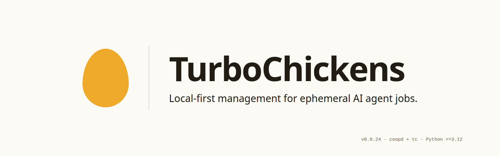

[](https://github.com/Korsdal/TurboChickens/actions/workflows/ci.yml)

# TurboChickens



TurboChickens is local-first management for ephemeral, just-in-time AI agent jobs: an Egg is candled, hatched into a Chicken by the Hatchery, and attested torn down by the Abattoir when the job ends.

Python >=3.12. One always-on daemon (coopd) plus one CLI (`tc`). Version 0.0.24.

## Quickstart

Install, either way:

```sh
uv sync                                       # creates .venv with turbochickens + dev tools
# or: python -m venv .venv && .venv/bin/pip install .
```

With the venv active (or via `.venv/bin/tc`), start the daemon in one shell:

```sh
tc daemon start
```

In another shell, candle and run the shipped example, then read its clutch:

```sh
tc jobs validate examples/weekly-incidents-digest/job.toml   # OK … sha256:18efbd8c…80b959
tc run examples/weekly-incidents-digest/job.toml --wait       # egg queued → chicken → succeeded
tc results get <run_id>                                        # the candled clutch, as JSON
tc status                                                      # coopd health, pecking order, alerts
```

The digest example runs on the mistral-api Feeder, so it needs `MISTRAL_API_KEY` in the environment (or a Perch seat — `tc auth login`; see [examples/providers.toml](examples/providers.toml)). The `examples/hello-vibe-cli` egg runs on the vibe-cli adapter instead.

For the Coop GUI, stop the daemon (`tc daemon stop`) and start it with the GUI enabled:

```sh
tc coop start    # serves the Coop at http://127.0.0.1:8737
```

By default the Coop requires a bearer token on every bind: when none is configured, coopd prints an ephemeral `coop auth token: …` line exactly once at startup — paste it into the login card. For a loopback-only dev setup, set `coop_loopback_open = true` in settings.toml with no `coop_auth_token` to leave the GUI open on 127.0.0.1. To run the whole farm as a container instead, see [docs/coop-container.md](docs/coop-container.md) — `docker build -t coop .`, then `docker run -p 127.0.0.1:8737:8737 -v coop-data:/data coop`.

## The lifecycle

A short tour in the farm's own terms — the full register is [docs/lexicon.md](docs/lexicon.md):

- **Egg + Candling** — a job spec (`job.toml` plus its prompt, schema, and attachments) is an Egg. `tc jobs validate` candles it: field-named errors, or OK plus a stable spec hash. Bundles uploaded from the Coop are candled and stored in the Uploads.
- **Pecking Order** — candled eggs queue by weight. The Hatchery admits chickens up to the weight budget (API chickens weigh 0.25, CLI chickens 1.0; the budget derives from machine size, overridable as `weight_budget_override`).
- **Hatchery + Free-Range + Feed Budget** — hatching gives each Chicken a fresh workspace (its Scratch) and runs it on a Feeder (`mistral-api` or `vibe-cli`). `resources.free_range = true` removes the wall-clock kill. The Feed Budget caps `timeout_sec`, `max_context_mb`, and `max_cost_usd` per egg.
- **Clutch + Nest Box + quarantine** — a finished Chicken lays a Clutch in the Nest Box; `tc results get <run_id>` serves only candled (schema-valid) clutches. A clutch that fails Candling is quarantined for inspection, never served.
- **Abattoir** — every terminal state (`succeeded`, `failed`, `cancelled`, `stopped`) ends with the Abattoir's attested teardown: workspace removed, `abattoir.attested` recorded in the Headcount. `tc runs stop <run>` and `tc runs rerun <run>` steer chickens, and Chaining lets one egg consume an earlier chicken's clutch via `nestbox://<run_id>/output.json`.
- **Compost** — retention: clutches rot away after `results_retention_months` (default 6); the Headcount is kept forever. The Feed Ledger (`tc stats list` / `tc stats show <job>`) rolls up tokens and expected cost per egg.
- **Rooster** — cron schedules: `tc schedule add <cron egg>`, `tc schedule list`, `tc schedule rm <job>`.
- **Perch** — seat auth: declare `auth = "seat"` in providers.toml and run `tc auth login <provider>` once; sessions live 0600 under the data dir and never in the Headcount.
- **Farmhand + Gates** — the Farmhand is an MCP server (17 tools over the daemon's socket ops) served on stdio and/or HTTPS at `farmhand_https_path` (default `/mcp`): `tc farmhand serve --transport stdio|https|both`. Registered Gates (connectors.toml, `tc connectors list|add|rm`) are opted into per egg with `harness.connectors = ["name"]`; secrets stay `$VAR` refs in every payload.
- **Beak** — a read-only live view into a running Chicken's workspace (tree, file peek, log tail: `GET /api/runs/<id>/workspace` and the Beak tab in the Coop). The Beak is closed once the Abattoir tears the chicken down.
- **Headcount** — the append-only audit log (`audit.jsonl`); every mutating row carries a `via` actor (`socket`, `http`, `farmhand`, `rooster`). Read it in the Coop's Headcount view or through the Farmhand's `audit_tail`.
- **Coop + Coopd + the Fence** — coopd is the always-on daemon; the Coop is the browser GUI it serves (`tc coop start`, http://127.0.0.1:8737). The Fox watches the Fence: bearer on every Coop bind unless opted out, path-locked workspaces, and restrictive permissions (0700/0600) on all state.

The coop remembers; the chickens don't.

## Read more

- [ARCHITECTURE.md](ARCHITECTURE.md) — how coopd, the Pecking Order, and the Hatchery fit together
- [SECURITY.md](SECURITY.md) — the Fence, the Fox, and the trust model
- [docs/lexicon.md](docs/lexicon.md) — the naming register every surface follows
- [docs/coop-container.md](docs/coop-container.md) — running the `coop` container
- [examples/](examples/) — runnable eggs plus the provider and gate registries
- [docs/sbom.cdx.json](docs/sbom.cdx.json) — the full dependency SBOM (CycloneDX)
- [CONTRIBUTING.md](CONTRIBUTING.md) — how to work on this repo
- [NOTICE](NOTICE) — third-party attributions
- [LICENSE](LICENSE) — MIT

Tip: set [docs/media/social-card.png](docs/media/social-card.png) as the repository social preview (GitHub → repository settings → Social preview).

## License

MIT — Copyright (c) 2026 Korsdal. See [LICENSE](LICENSE).
