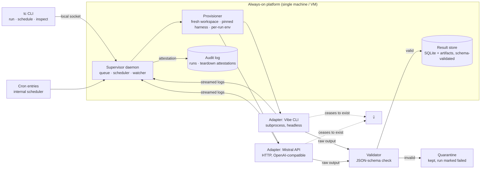
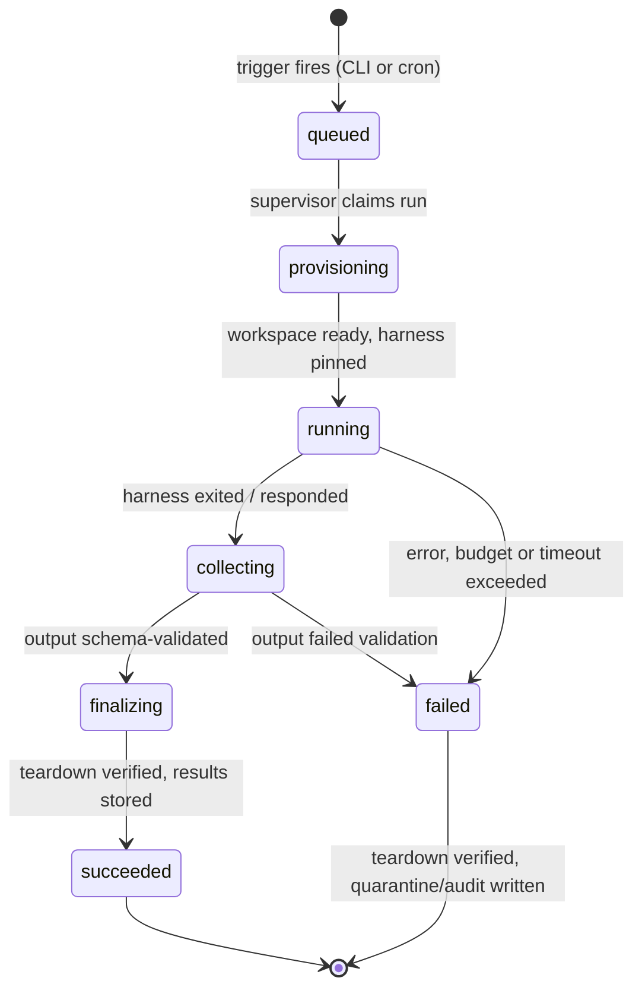

# TurboChickens — Baseline Spec (v0.2)

> A local-first management platform for **ephemeral, just-in-time AI agents**. Agents are jobs, not co-workers: spawned by something deterministic, they do a defined job, hand over the results, and cease to exist. The server is always on. The agents never are.

## 1. Philosophy

The core inversion: **the platform is the durable thing; agents are processes.**

1. **Agents are jobs, not services.** No persistent agent identity, no always-on session, no ambient memory. Every run gets a fresh workspace and a clean death.
2. **Determinism at spawn time, not behavior time.** The LLM stays probabilistic; the *environment* is pinned (harness version, model, provider, temperature, inputs, budget). Jobs are designed idempotent so a re-run is always safe.
3. **State lives in the platform.** If run B needs run A's findings, A's validated *output* is passed to B explicitly. Never "A's memory."
4. **Outputs are untrusted data.** Results are schema-validated before entering the result store and are never auto-executed by the platform.
5. **Destruction is enforced and attested, not assumed.** A run isn't done until teardown is verified.
6. **Control time and context; measure cost.** The enforced budgets are wall-clock time and injected context size. Token usage is telemetry, not a spec knob: repeated runs of a job converge to an expected token count and cost per run, and a run that deviates from that expectation is an alert, not an invoice surprise.

## 2. Context and relation to Sluse

Standalone hobby project. Related to Sluse (agents in a VM box, brokered file access, host-side credential custody) and Sluse may draw on this solution later. Consequence: keep the **job spec format** and **harness adapter interface** free of any Sluse-specific concepts, and leave a **credential-provider extension point** so a Gate Core–style host broker (keys held outside the agent's environment) can slot in later without redesign.

## 3. Architecture

One always-on supervisor daemon, local triggers, pluggable harness adapters, ephemeral per-run workspaces, and an append-only result store.



## 4. Core concepts

| Concept | Meaning |
| --- | --- |
| **Job spec** | Declarative TOML file: trigger, harness, model, inputs, output schema, budget. The unit of definition. |
| **Run** | One execution of a job. Has an ID, a lifecycle, logs, a manifest, and exactly one terminal outcome. |
| **Harness** | The runtime that actually talks to a model: a CLI agent (Vibe CLI) or a raw API (Mistral). |
| **Adapter** | Platform-side plugin that knows how to provision, execute, and tear down one harness type. |
| **Workspace** | A fresh, per-run directory (and later, container). Nothing is shared between runs. |
| **Trigger** | Deterministic cause of a run: manual CLI or cron. Event/webhook comes later. |
| **Result** | Schema-validated output + artifacts, keyed by run ID. The only thing that survives a run. |
| **Manifest** | Pinned environment record per run: spec hash, harness + version, provider, model, temperature, token usage, timestamps. Enables reproducible *environments*. |
| **Trajectory** | A job's durable, versioned continuity: findings and conclusions from previous runs. Owned by the platform, *proposed to* by the agent; validated updates become drafts that only human acceptance commits. Long-lived context for short-lived agents (post-MVP, Section 11). |

## 5. Run lifecycle



## 6. Job spec format (TOML)

```toml
[job]
name = "weekly-incidents-digest"
description = "Summarize the week's security incidents into a structured digest"

[trigger]
type = "cron"            # "cron" | "manual"
schedule = "0 7 * * 1"   # Monday 07:00, cron syntax

[harness]
adapter = "mistral-api"  # "mistral-api" | "vibe-cli"
model = "mistral-large-latest"
temperature = 0.1

[resources]
timeout_sec = 600        # hard kill: wall-clock budget
max_context_mb = 2       # hard cap: prompt + attachments + injected state
                         # (default derived from the model's context window, overridable)
network = "none"         # MVP: declared policy; enforced post-MVP

[input]
prompt_file = "prompts/digest.txt"
attachments = ["inputs/incidents.csv"]

[output]
format = "json"
schema_file = "schemas/digest.schema.json"
```

Note the deliberate absence of a `max_tokens` knob. Token usage is *not* a budget declared in the spec — it is measured per run by the adapter and rolled up into **per-job usage statistics** (see Section 8, item 10). Provider/model pricing lives in a platform-level `providers.toml`, so after 4–5 runs a job has a stable expected cost (e.g., ~55k tokens ≈ $0.14 at $2.55/Mt) and deviations get flagged. Time and context are enforced; cost is predicted. Artifact size caps work the same way: defaults derive from each model's context window in `providers.toml`, overridable per job.

## 7. Harness adapter interface

```python
class HarnessAdapter(Protocol):
    name: str

    def prepare(self, run: RunContext) -> PreparedRun:
        """Pin the harness identity (version, model, provider), build the
        per-run env template. No secrets in the workspace itself."""

    def execute(self, prepared: PreparedRun) -> HarnessResult:
        """Run the job inside the workspace. Stream log lines to the
        supervisor, return raw output + usage + exit status."""

    def teardown(self, run: RunContext) -> TeardownReport:
        """Confirm: process reaped, workspace directory verified gone,
        per-run env cleared. Returns an attestation record."""
```

**MVP adapters**

1. **`vibe-cli`** — headless subprocess run (`vibe --print`-style mode), cwd pinned to the workspace, stdout/stderr captured as logs, final message captured as raw output. Config `config.toml` provider/model presets map naturally onto the job spec.
2. **`mistral-api`** — HTTP client (OpenAI-compatible request shape) against Mistral; JSON-mode structured responses where the model supports it. Same client shape keeps TensorX and other OpenAI-compatible EU providers a config change, not a code change.

Both adapters implement exponential backoff on provider rate-limit responses (429/5xx): provider-side limits, not local silicon, are the real ceiling for API runs.

## 8. MVP scope

**In:**

1. Job spec parsing + validation (Pydantic-backed TOML schema)
2. Supervisor daemon: queue, internal cron scheduler, process watcher, resource-weight admission control (decision 2 in Section 14)
3. The two adapters above
4. Per-run ephemeral workspace (fresh temp dir, job-scoped env)
5. Result store: SQLite + on-disk artifacts, JSON-schema output validation, quarantine on invalid output
6. Teardown attestation + append-only audit log
7. Run manifest for environment reproducibility
8. CLI: `tc run`, `tc schedule add/list/rm`, `tc runs list/show/logs`, `tc results get`, `tc status`
9. Run budgets — the two controlled quantities: wall-clock timeout hard-kill and injected-context size cap; adapters report token usage per run in the manifest
10. Usage statistics: per-job rolling stats over repeated runs (n, mean/p50/p95 tokens in+out, expected cost per run from `providers.toml` pricing)
11. Retention: settings-managed TTLs — audit log keeps forever by default, results expire after 6 months by default; every deletion is audit-logged

**Out (explicitly, for now):**

- Event/webhook triggers
- Container/VM-level workspace isolation (declared `network` policy recorded but not enforced)
- Multi-node, web UI, notifications, RBAC
- Cross-job chaining (pass outputs manually until there's a reason to automate it)
- Credential brokering beyond per-run env vars (interface reserved)

## 9. Stack

- **Platform:** Linux (MVP). Windows users run an Ubuntu VM — separation of concerns; native Windows support is post-MVP
- **Python 3.12+**, `uv` + `pyproject.toml`, single installable package `turbochickens`, CLI entry point `tc`
- **Daemon:** `asyncio` single process; local IPC over a Unix domain socket (JSON-lines) so manual runs flow through the same queue as cron runs — one source of truth
- **Scheduling:** APScheduler (cron)
- **CLI:** Typer + Rich
- **Validation:** Pydantic v2 (spec parsing) + `jsonschema` (output validation)
- **Storage:** stdlib `sqlite3` (runs, events, results index, attestations) + plain files for artifacts and JSONL audit trail
- **HTTP:** `httpx` (adapter-side, OpenAI-compatible shape)
- **Harness subprocesses:** `asyncio.subprocess`

## 10. Security model (baseline)

1. **Least-privilege spawn.** Runs execute with a fresh workspace and no ambient secrets. Credentials are injected as per-run env vars and cleared at teardown. The credential-provider interface exists so env injection can later be replaced by a host-side broker (Sluse/Gate Core pattern).
2. **Validated results channel.** Raw output is untrusted until it passes the job's JSON schema. Invalid output is quarantined (kept for inspection, run marked failed) — never discarded, never stored as valid.
3. **Teardown attestation.** Every terminal state requires: process confirmed dead → workspace directory confirmed absent → env cleared → audit row written. A run without a teardown attestation is itself an alerting condition.
4. **Determinism manifest.** Spec hash, harness version, provider, model, temperature, and timing recorded per run; any deviation between manifest and outcome is visible.
5. **Logs are data, not instructions.** Streamed harness logs are sanitized for control characters and stored read-only. No log line is ever interpreted by the platform.
6. **Blast radius.** Fresh filesystem per run; result store is append-only; audit log is append-only JSONL.

## 11. Trajectory loops — long-lived context for short-lived agents

Backlog item, designed here so the MVP doesn't preclude it. The pattern: **the platform owns job continuity, not the agent.** A job has a durable, versioned *trajectory* — what previous runs found, concluded, and left open — and each run is a fold over it: `trajectory_new = f(trajectory_old, run)`.

1. **In.** The provisioner injects the current trajectory snapshot into the run as an explicit input artifact, inside the job's context budget. The agent reviews it alongside the fresh prompt and new data.
2. **Out.** The output schema reserves a `trajectory_update` section. The agent *proposes* what it learned and how the trajectory should move.
3. **Accept.** Validated updates land as *drafts*: parked, diffed against the current trajectory, never active. Only human acceptance commits a new versioned trajectory entry. Whether the human actually reads the diff is their call — their data, their decisions. The platform's guarantee is only that no acceptance means no commit: the agent can never move its own trajectory.

Guards (this is agent continuity, so it inherits the security posture):

- **The agent never writes trajectory directly** and never holds more than a snapshot; a poisoned run can propose garbage, but it lands in quarantine like any other invalid output.
- Trajectory size is capped; when it grows past the cap it is summarized/compressed, and the compression event is logged like any other commit.
- Every version is diffable, logged, and revertible. Trajectory history is append-only, like results and audit.

The coop remembers; the chickens don't.

## 12. Data model (SQLite, sketch)

- `job_specs(id, name, spec_hash, spec_toml, created_at)`
- `runs(id, job_id, status, trigger, started_at, finished_at, manifest_json, usage_json)`
- `run_events(run_id, seq, ts, level, source, line)` — streamed logs
- `results(run_id, valid, output_json, artifacts_dir, schema_errors)`
- `teardown_attestations(run_id, process_reaped, workspace_removed, env_cleared, verified_at)`
- `job_usage_stats(job_id, n_runs, tokens_in_mean, tokens_out_mean, tokens_p95, expected_cost, updated_at)`
- `trajectory_drafts(run_id, proposed_json, diff_json, created_at)` — validated, awaiting human acceptance — post-MVP
- `trajectories(job_id, version, state_json, diff_json, accepted_by, created_at)` — committed by human acceptance — post-MVP

## 13. Post-MVP roadmap (order negotiable)

1. Container-isolated workspaces → `network` policy actually enforced
2. Event/webhook triggers
3. Trajectory loops (Section 11): agent reviews its last findings and proposes updates; human acceptance of drafts commits versions
4. Cross-job explicit output passing (job spec references another job's validated result)
5. Cost-deviation alerting: run usage flagged against the job's expected envelope
6. Credential brokering via host-side provider (Gate Core–style)
7. Web UI / TUI dashboard over the same local socket
8. Additional adapters (Claude Code, Codex headless) to stress the adapter layer
9. Per-job-type result retention policies (on top of the global TTL settings shipped in the MVP)

## 14. Decision log (v0.2)

1. **Platform:** Linux-only for MVP. Windows users run an Ubuntu VM — separation of concerns, and likely the saner architecture on Windows anyway. Native support post-MVP.
2. **Concurrency:** resource-weight admission, not a fixed chicken count. API runs weigh **0.25** — one HTTP call, local cost is a few tens of MB and negligible CPU; the real ceiling is provider-side rate limits. CLI-agent runs weigh **1.0** — a Node-based agent process at ~0.3–1 GB RSS, CPU-bursty and mostly idle while awaiting inference. Weight budget defaults to `max(1, min(vCPU, floor(RAM_GB / 1.5)))` with a settings override. On a 4 vCPU / 8 GB VM that is budget 4: four CLI chickens, or sixteen API runs, or a mix — the API jobs never starve behind CLI jobs. Over-budget runs backlog in the queue; nothing is rejected.
3. **Retention:** TTLs for everything, managed via settings. Defaults: audit log keeps forever, results expire after 6 months. Deletion events are audit-logged. Per-job-type retention policies → backlog (roadmap item 9).
4. **Artifact caps:** capped, but variable — defaults derive from the harness/model profile (context window) in `providers.toml`, overridable per job.
5. **Trajectory policy:** validated updates land as drafts; only human acceptance commits a version. Whether the human actually reviews is their business — their data, their decisions. The platform guarantees only: no acceptance, no commit.
6. **Name:** TurboChickens. Final. It is funny and memorable, and the intended users are Johannes and parts of his network.

---
*TurboChickens — baseline spec v0.2.*